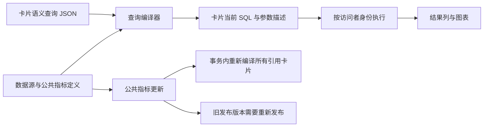
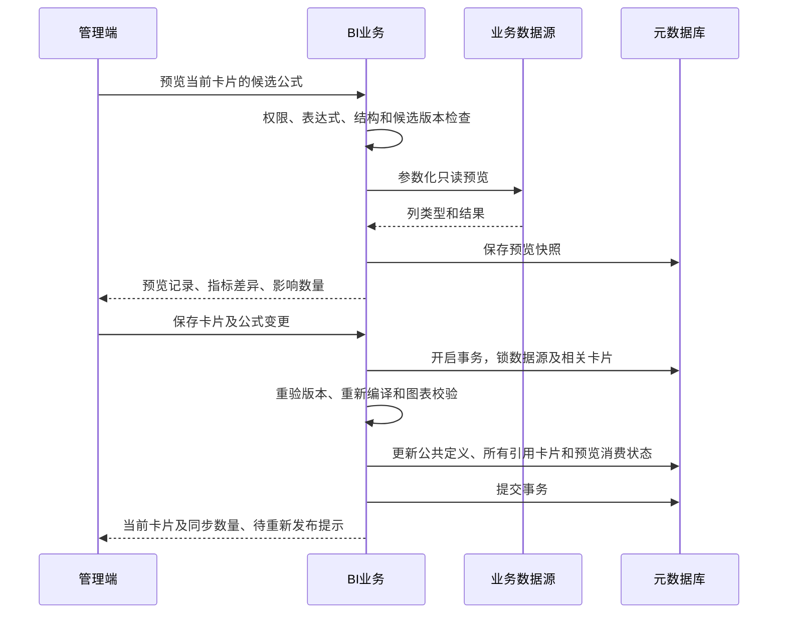

# BI 卡片 SQL 与公共指标同步详细设计

日期：2026-11-14。状态：实现及独立审查修复完成，验证结果与存量边界见实施计划。实现范围为公共指标公式编辑、卡片执行定义持久化、事务同步和发布修订校验。

## 1. 用一个例子说明目标

数据源有一个公共指标 `sales_amount`（销售额），原公式为 `SUM(amount)`。卡片 A 按天统计，卡片 B 按门店统计，两张卡片各自保存完整的参数化 SQL。

管理员在卡片 A 中把指标公式改为 `SUM(amount - refund_amount)`，预览后保存。系统在同一次提交中：

1. 更新数据源中的 `sales_amount` 定义。
2. 更新 A、B 等所有引用该指标的现存卡片 SQL，保留各自的分组、筛选、时间配置和样式。
3. 让后续问数使用新的指标定义。
4. 将引用旧定义的已发布仪表盘标为“需要重新发布”，阻止它继续按旧口径取数。

因此，一张卡片拥有一份 SQL，但相同公共指标的计算规则只有一份。不同时间和筛选下的指标值可以不同，公式和业务口径必须一致。

如果原“销售额”应继续保留，净销售额应另建指标 `net_sales_amount`，不能把两个定义都命名为“销售额”。

## 2. 已确定的需求和设计取舍

### 2.1 已确定的需求

| 事项 | 规则 |
| --- | --- |
| SQL 归属 | 一张卡片拥有一份当前 SQL，不建立独立 SQL 库或可复用数据集管理功能 |
| 初始 SQL | 由语义查询 JSON 和数据源模型生成，随卡片持久化 |
| 人工修改范围 | 先支持修改指标公式；维度、筛选和表关联继续通过现有配置维护 |
| 指标同步 | 修改卡片中的公共指标公式时，同时更新数据源公共指标和所有引用卡片 |
| 指标一致性 | 同一数据源内，一个公共指标只有一个固定定义，不能由卡片另选聚合函数 |
| 卡片复用 | 不同仪表盘引用卡片；复制卡片后仍引用相同公共指标 |

### 2.2 本方案给出的具体设计选择

以下是为使方案可实施而确定的设计默认值，不把它们表述为此前已经实现的能力：

- SQL 编辑器编辑指标表达式，完整 SQL 提供只读预览；不接受客户端提交任意完整 SQL 直接执行。
- 公共指标复用 `bi_source.schema_json` 保存，不新增指标表；指标依赖从同数据源卡片的查询 JSON 中读取，不增加关系表。
- 指标变更和相关卡片 SQL 在一个元数据库事务内同步；任一编译或写入失败则整体回滚，不允许只更新部分卡片。
- 已发布快照保持不可变，但旧指标版本失效后停止继续执行，提示所有者重新发布。历史查询结果仍可作为历史记录查看。
- 不同数据源可以有同名指标；同一租户、同一数据源内的指标编码和名称分别唯一。内部关联使用编码，不使用名称。
- 配置型数据库源支持公式编辑；代码注册的 `SourceAdapter` 继续由代码维护指标，页面不改写宿主业务代码。

## 3. 改造前行为与实现范围

| 位置 | 改造前行为 | 本次实现 |
| --- | --- | --- |
| `backend/internal/biz/bi/admin/sql_source.go` | 根据查询规格即时生成 SQL 和参数，指标为物理列加聚合函数 | 复用表关联、过滤和方言渲染，加入指标表达式编译和可保存的 SQL 参数描述 |
| `backend/internal/biz/bi/admin/dto/source.go` | 指标包含 `table`、`column` 和允许的 `aggregations` | 改为固定聚合表达式、单位和指标修订号 |
| `backend/pkg/bi/types.go` | 每次查询选择指标编码及聚合方式 | 每次查询只选择指标编码，聚合属于公共指标定义 |
| `backend/internal/biz/bi/admin/bi_card.go` | 保存语义 JSON 和图表配置，取数时执行 JSON | 增加编译产物、公式预览、公共指标同步和卡片并发版本校验 |
| `backend/internal/biz/bi/admin/bi_query.go` | 预览、问数和执行记录围绕语义规格组织 | 查询哈希加入实际指标定义版本，记录执行 SQL 快照和来源类型 |
| `backend/internal/biz/bi/admin/bi_dashboard.go` | 发布时固定查询和展示快照 | 固定 SQL 及指标版本；读取、执行和发布时校验当前指标版本 |
| `frontend/admin/packages/modules/bi` | 指标选择包含聚合方式，图表依赖语义字段和结果列 | 固定指标选择、公式编辑、变更预览及待重新发布提示 |

当前 Go 模块声明 `go 1.27.3`。当前查询限制为默认 100 行、硬上限 1000 行、15 秒超时、48 KiB 结果限制；方案沿用这些限制，不新增可配置开关。

现有卡片必须关联当前用户、当前项目下成功的智能问数记录，且查询与记录完全一致。目标方案保留创建来源追溯，同时把“创建来源”和“编辑后的成功预览”分开，不能继续只靠原问数 JSON 相等判断编辑有效性。

本次设计只涉及本仓库后端、管理端和初始化权限数据。当前未发现 uni-app、Taro 中有 BI 页面或 BI RPC；不增加两个应用端的 SQL 编辑入口。共享 BI 查询契约、AI 工具和代码注册 Adapter 仍需同步调整并验证。

## 4. 方案比较

| 方案 | 优点 | 代价与结论 |
| --- | --- | --- |
| 每张卡片自由维护 SQL，指标互不关联 | 编辑简单 | 同名指标容易出现不同定义，不满足本次要求 |
| 独立 SQL 数据集，多张卡片共享查询 | 查询复用充分 | 新增资产层和管理流程；本次已经选择以卡片为 SQL 归属单元，不采用 |
| 卡片保存 SQL，公共指标统一定义并同步编译 | 满足一对一 SQL、公共指标一致和现有卡片复用方式 | 需要受控表达式和事务同步；采用此方案 |

不尝试把任意 SQL 双向还原成语义 JSON。查询 JSON 继续描述维度、筛选、时间和指标引用；公共指标描述计算规则；SQL 是二者编译后的执行产物。手工修改公式通过更新公共指标进入这条链路，不形成第二份独立口径。

## 5. 模型关系与一致性边界



- 卡片与当前执行定义为一对一，SQL 内容可以重复，不对 SQL 文本建立唯一约束。
- 卡片与公共指标为多对多；公共指标以 `(tenant_id, source_code, metric_code)` 标识。
- 卡片与执行记录为一对多；卡片 SQL 更新不修改历史执行 SQL、结果或问题。
- 数据源编码和指标编码创建后不可改；改名只修改展示名称。引用中的编码不能随名称变化。
- 相同指标意味着相同公式、单位及固定计算条件。卡片分组、时间范围和业务筛选不同不等于指标定义不同。
- 公共公式仅引用事实表物理字段，不能引用其他公共指标；避免本期增加依赖图、循环引用和嵌套指标展开。

## 6. 公共指标定义

### 6.1 目标结构

`schema_json` 的 `measures` 改为以下结构，表、关联和维度继续沿用已有结构：

```json
{
  "model_revision": 3,
  "measures": [
    {
      "code": "sales_amount",
      "name": "销售额",
      "type": "number",
      "expression": "SUM(amount - refund_amount)",
      "unit": "元",
      "revision": 5
    },
    {
      "code": "order_count",
      "name": "订单数",
      "type": "number",
      "expression": "COUNT(*)",
      "unit": "笔",
      "revision": 2
    }
  ]
}
```

- `expression` 是规范化后的聚合表达式，是唯一计算定义；删除指标中的 `table`、`column`、`aggregations`，不保留并行解释路径。
- `type` 本期固定为 `number`。计数、金额、平均数和比例均可为指标；数字编号仍应建为维度。
- `revision` 由服务端维护，取该指标最近一次定义变更提交后的 `bi_source.version`，不作为从 1 开始的独立计数。新增及公式、名称、单位变更都取得新的源版本值；未变指标保留原修订。仅空白和函数大小写改变，规范化后相同时不改变指标修订。
- 同一源的 `version` 单调递增，不能回退或重置。因此删除指标后，即使以后重新使用相同编码，新修订也必须大于所有旧修订，不会与历史公式身份重合。保留现有包含软删除记录的租户/源编码唯一约束，不允许通过删除重建同编码数据源重置版本身份。
- `model_revision` 由服务端维护，表、关联、维度、字段类型等影响查询结构或结果元数据的变化使其加 1；画布坐标和连接密码变化不增加它。
- 现有 `bi_source.version` 继续作为数据源修改的并发版本。它与上面两个修订号用途不同，不能用密码更新使所有发布快照失效。
- 名称按原字符串比较唯一，不自动 trim 或大小写转换；拒绝纯空白、首尾空白名称，避免用空格制造看似同名的不同指标。编码复用现有标识符格式检查，且不能与维度编码重复。
- 每个指标固定聚合口径。`SUM(amount)` 与 `AVG(amount)` 应分别定义为“销售额合计”和“平均订单金额”，查询请求不能再覆盖聚合函数。

### 6.2 本期表达式语法

支持下列封闭语法；先解析成有类型的表达式树，再渲染 SQL，不能把表达式字符串原样插入查询。

| 分类 | 支持内容 |
| --- | --- |
| 字段 | 已发现且在事实表中的物理字段；金额运算字段必须为数值类型 |
| 数值 | 十进制整数、十进制小数；不接受指数形式、十六进制和非有限值 |
| 运算 | `+`、`-`、`*`、`/`、括号、正负号 |
| 聚合 | `SUM`、`COUNT`、`AVG`、`MIN`、`MAX`；`COUNT(*)` 和 `COUNT(field)` |
| 空值与比例 | `COALESCE`、`NULLIF`、`NULL`；例如 `SUM(profit) / NULLIF(SUM(amount), 0)` |

语义检查规则：

1. 顶层表达式必须包含聚合；所有物理字段必须处于聚合内部，不接受未分组的裸字段。
2. 聚合函数不能嵌套；允许两个聚合结果之间运算。`COUNT` 可接非数值字段，其余本期聚合输入为数值表达式。
3. `COALESCE`、`NULLIF` 只允许数值或空值参数，校验参数个数和聚合层级，不能借其混入裸字段。
4. 表别名由生成器提供；公共表达式保存事实表字段名，不能自行选择其他表、Schema 或数据源。
5. 单个表达式最长 2048 字符、最多 512 个语法节点、最多 32 层嵌套；作为代码常量限制，不增加配置项。
6. 除法定义为精确数值除法，渲染 `/` 时把左侧表达式乘十进制常量 `1.0`，避免 PostgreSQL 整数除法截断；不转换为浮点。小数位沿用目标数据库的精确数值规则，本期不提供跨库固定 scale。规范化不能把该十进制常量折叠成整数。
7. 除零不自动改写公式，用户应通过 `NULLIF` 明确零分母处理；空集合的 `SUM/AVG/MIN/MAX` 保留 `NULL`、`COUNT` 保留 0，需要补 0 时显式使用 `COALESCE`。预览遇到数据库错误时不能保存。
8. 本期不支持字符串常量、`CASE`、`DISTINCT`、子查询、CTE、窗口、任意数据库函数、注释、分号、变量、存储过程或文件/网络函数。

词法分析使用 Go 标准库 `text/scanner`，只开放上表的 token 和文法；不接受由扫描器额外识别出的 Go 语法，不使用正则表达式替代语法解析。当前依赖及已检查的 `kratos-kit`、`go-utils`、`gorm-kit` 手写代码中未发现可直接复用的 SQL 表达式解析能力。本期不为有限表达式引入通用 SQL 解析器。

规范化保存函数大写、十进制常量和统一括号；字段标识符保留实际大小写。MySQL/Doris/TiDB 和 PostgreSQL 的引号、占位符交给现有方言渲染能力处理，不能因为 MySQL 中能够运行就宣称其他方言通过验证。

## 7. 数据库存储

### 7.1 复用现有表

不新增 SQL、数据集、指标或依赖关系表。新字段通过开发库结构和 `make -C backend gorm-gen` 生成，不手改 GORM 产物。

| 表 | 字段变化 | 用途 |
| --- | --- | --- |
| `bi_source` | 扩展 `schema_json` 内指标结构及 `model_revision`，容量由 TEXT 调整为 MEDIUMTEXT，复用 `version` | 保存公共定义和并发版本，避免多个较长公式超出原 64 KiB 文本容量 |
| `bi_card` | 新增 `execution_json JSON`，非空 | 服务端生成的 SQL、参数描述、指标版本和结果字段 |
| `bi_card` | 新增 `version BIGINT`，非空，初始 1 | 卡片编辑及级联同步的并发版本 |
| `bi_card` | 新增 `validation_query_record_id BIGINT`，非空，初始 0 | 最后一次由用户成功预览并应用的记录；不冒充创建来源 |
| `bi_query` | 新增 `kind SMALLINT`、`card_id BIGINT` | 区分问数、普通预览、卡片公式预览、卡片取数和仪表盘取数 |
| `bi_query` | 新增 `execution_json JSON`、`context_json JSON` | 冻结执行定义，以及编辑候选、前后指标定义和来源上下文 |
| `bi_query` | 新增 `applied_card_id BIGINT`、`applied_card_version BIGINT`，默认 0 | 原子消费预览，避免重复保存创建多个卡片 |
| `bi_dashboard_version` | 不增加列，扩展 `schema_json` 中发布快照 | 保存执行定义与指标版本；布局结构版本从 3 更新为 4 |

继续使用卡片已有 `(tenant_id, source_code)` 索引查同源卡片，在 Go 中按指标编码筛选。新增查询索引使用 `idx_bi_query_card_id_created_at`，列为 `card_id, created_at`。除业务需要的这些索引外，不对 SQL 或 JSON 内容建立索引。

### 7.2 卡片执行定义

`execution_json` 为闭合的服务端结构，客户端不能直接落库：

```json
{
  "version": 1,
  "kind": "configured_sql",
  "driver": "mysql",
  "model_revision": 3,
  "sql": "SELECT SUM(`t0`.`amount` - `t0`.`refund_amount`) AS `sales_amount` FROM `orders` AS `t0` WHERE `t0`.`tenant_id` = ? LIMIT 101",
  "parameters": [
    { "position": 1, "kind": "scope", "field": "tenant_id" }
  ],
  "metrics": [
    { "code": "sales_amount", "revision": 5 }
  ],
  "columns": [
    { "code": "sales_amount", "name": "销售额", "type": "number", "role": "measure", "unit": "元" }
  ],
  "hash": "服务端计算的SHA256值"
}
```

- SQL 中保留占位符，不保存当时登录人的租户 ID、项目 ID 或已解析的相对日期。
- 参数描述记录来源及位置，例如可信身份、查询过滤值下标、时间范围起止。参数值从服务端身份和经过校验的卡片查询规格中绑定。
- 执行定义哈希覆盖驱动、规范化查询规格、结构修订、引用指标版本、SQL、参数描述和结果字段；不包含随执行变化的身份与时间值。
- 查询 `limit` 只按默认 100 行和固定硬上限 1000 行归一化；数据源可变的 `MaxRows` 约束执行定义的有效 `limit`，不改写原查询及其身份。源上限变化后按原规格重新编译卡片，重新发布、展示保存和公式预览沿用该规格。
- 卡片 `query_json` 仍保存原有维度、筛选和时间等业务配置，指标仅保存编码。公式只存在于公共定义中，执行 SQL 是它的编译副本。
- `SourceAdapter` 的执行定义使用 `kind=adapter`，不伪造 SQL；保存指标编码和 Adapter 描述版本用于验证。

`bi_query.execution_json` 冻结该次实际使用的定义，`context_json` 保存预览所对应的数据源版本、卡片版本、原问数 ID、候选公式差异和候选哈希。历史字段不随公共指标更新改写；消费状态只更新独立的 `applied_*` 字段。

## 8. SQL 编译、时间参数和结果字段

### 8.1 编译流程

1. 校验数据源可用性、来源类型、调用者可信范围及查询字段。
2. 用公共指标编码取得固定公式和版本，解析为表达式树。
3. 复用现有事实表、多对一关联和维度映射；为所有被声明为共享的表生成可信租户条件。
4. 根据卡片配置生成维度、过滤、分组、排序和行数上限。
5. 生成 SQL、参数来源描述和完整结果字段，得到执行定义。

卡片保存后，默认取数使用已经保存的 SQL 和参数描述。SQL 仅在卡片查询配置、公共指标或查询结构改变时重新编译，不在每次请求中通过字符串替换修补公式。

### 8.2 时间范围

沿用 `range_days=0/7/30` 的页面语义。编译时从已配置的日期维度确定唯一时间轴，为其生成“时间过滤是否启用＋开始＋结束”的受控参数条件；业务已有的同日期过滤要归并到该时间轴，避免叠加旧条件。

- `0` 使用卡片时间配置，相对日期在执行时按现有服务器时间规则解析。
- `7/30` 只替换同一个日期轴的起止值，不改变其他业务过滤和租户条件。
- 未配置可用日期轴时，不额外生成时间条件，保持当前非日期卡片的行为。
- `IN` 条件的占位符个数属于已保存查询结构；过滤值列表长度变化需要重新编译，不能将列表拼进 SQL 字符串。
- 两种驱动分别验证参数顺序、空时间值的类型推断和启用开关行为。

### 8.3 结果字段和图表

- 结果字段由受控维度及公共指标定义产生，并用数据库预览的列名和类型验证；不能只靠“数值列”自动认定指标。
- 公式更新保持指标编码及输出别名不变，图表映射通常可以保留；指标名称和单位从新公共定义同步更新。
- 现有散点、桑基、热力、旭日、指标卡等校验继续执行。图表绑定引用不存在的字段时拒绝保存，不静默改绑其他列。
- 公式类型固定为数值，预览的驱动类型、空值及 decimal 处理必须与当前字符串形式的结果行约定一致；不把金额转成浮点数后再序列化。
- 本期不允许在卡片 SQL 中任意增加、删除或重命名输出列。选择其他指标和维度仍走已有表单。

## 9. 卡片预览与保存

### 9.1 创建卡片

1. 从当前账号和项目下成功的智能问数记录进入，保留原 `query_record_id`。
2. 生成当前公共指标版本下的初始 SQL。若原问数的指标已变更，提示需要重新问数，不把旧结果当成新公式结果。
3. 用户可以编辑已选择指标的公式；未持有数据源模型修改权限时，公式只读，仍可调整自己的展示配置。
4. 成功预览后获得 `preview_query_record_id`，其中冻结精确候选定义和结果。
5. 保存时校验创建来源、预览归属、候选哈希、数据源版本及图表映射；公共公式存在变化则与数据源及相关卡片一起提交。

### 9.2 编辑卡片

公式编辑不再要求重新自然语言问数，但必须成功预览。原问数 ID 保持不变，新的成功预览记入 `validation_query_record_id`。

仅修改名称、图表类型、样式、刷新和共享配置时，不要求重复执行 SQL；仍做版本和现有字段映射校验。新增或切换指标、修改维度和业务查询条件仍按现有来源规则重新问数；不能借公式编辑扩大查询结构。

预览绑定当前租户、用户、项目、卡片 ID/版本和数据源版本。修改公式、查询结构或候选公共指标名称/单位后必须重新预览；修改样式不使同一 SQL 预览失效。

候选公式只在本次预览的内存模型中覆盖当前定义，不提前更新数据源或卡片。使用旧源版本进行的预览，即使执行成功，也不能在公共模型已经变化后保存；记录为成功执行不等于获得永久写入资格。

预览只执行当前编辑卡片，并使用当前访问者范围；不能为检查其他人的卡片而借用其身份执行数据库查询。

### 9.3 系统级联更新的验证来源

卡片 B 因其他卡片修改公共指标而重新编译时，保留 B 的原问数和最后一次人工预览记录，不把 A 的预览记为 B 的人工验证，也不要求 B 的所有者重新问数。

系统级联编译是合法的受信派生更新：当前执行定义必须能由 B 原有查询规格及当前公共模型重新编译得到，并通过类型和图表静态检查。保存展示配置及重新发布时，校验该事实和原始来源链，不要求旧人工预览中的 SQL 哈希等于已经同步更新的 SQL。

客户端不能提交“已系统同步”等标志来取得这条路径。客户端直接改变公式或查询内容仍须按相应来源、权限及成功预览规则处理；只有统一指标事务能更新其他卡片的派生执行定义。

### 9.4 重复保存

保存事务对预览记录加锁，仅允许消费一次。相同预览再次保存返回 `CONFLICT`，附已保存的卡片 ID/版本，前端定位并重新读取，不再创建第二张卡片或重复增加指标版本。客户端收到网络失败后不能直接生成新预览并重建，应先处理原预览的已应用状态。

## 10. 公共指标事务同步

### 10.1 统一入口

卡片公式保存、数据源模型保存都调用同一套指标变更与编译逻辑。不能让 `SaveBiSourceModel` 直接覆盖 JSON 绕过卡片同步。数据源模型预览也使用同一套校验和影响分析。

最外层 Case 开启元数据库事务，内部方法只使用传入的事务上下文，不自行独立提交。数据源领域逻辑负责指标定义和派生 SQL 更新，卡片 Case 负责当前卡片及来源规则；纯表达式和查询编译逻辑不持有 Repository。

### 10.2 提交流程



具体顺序：

1. 在事务外完成当前卡片的真实预览，以及数据源模型变更需要的元数据发现、公式解析和方言检查。
2. 进入事务后按数据源 ID 升序锁数据源，检查 `expected_source_version`；修改卡片时再锁预览记录。
3. 查询同租户、同数据源所有未删除卡片，按 ID 升序锁定，检查当前编辑卡片的 `expected_card_version`。
4. 对比当前与候选模型，计算指标修订和结构修订；读取每张卡片的查询 JSON，找出所有实际依赖，不只处理操作者可见的卡片。
5. 在内存中重新编译受影响卡片，校验结果字段和图表映射。当前编辑卡片使用其候选表单，其他卡片仅更新派生执行定义。
6. 全部通过后，更新公共模型、受影响卡片执行定义及卡片版本；当前卡片的来源、展示变更和预览消费也在同一事务提交。当前卡片只增加一次版本。
7. 任何校验、编译、版本比较或数据库更新失败则回滚全部写入，不以“部分同步成功”返回。
8. 提交后按既有异步日志链路记录前后指标定义、操作者、来源卡片及同步数量；日志投递失败沿用日志系统回退机制，不把异步日志当作事务提交凭据。

事务中不访问业务数据库、不调用模型、不发送通知。关联卡片较多时可分批读取、更新，但仍在一个事务内，不跨事务分批放行新口径。本期不引入异步同步队列；将来若同步耗时超出请求预算，需另行设计带版本屏障的批量同步，不能直接改成最终一致。

### 10.3 并发和取数

- 所有卡片创建、查询修改、指标更新和发布操作采用相同锁顺序：数据源按 ID 升序 → 预览记录（存在时）→ 卡片按 ID 升序 → 仪表盘/版本（存在时）。普通样式保存也必须检查卡片版本。
- 多个管理员同时编辑同一数据源时，仅基于最新版本的提交成功，另一方返回 `CONFLICT` 并保留本地输入供重新预览。
- 修改公共指标不取得其他卡片内容的编辑权：级联只写派生 SQL、结果字段及版本，不改所有者、项目、筛选、分组、名称、样式和共享状态。
- 取数开始时校验当前执行定义的结构和指标修订。旧版本不允许静默执行；取数期间发生指标更新，返回结果前再次检查版本，过期结果丢弃并提示刷新。
- 版本校验界定请求的一致性时点，不保证所有已打开浏览器画面立即重绘。返回指标版本和查询时间；当前页面完成变更后重取受影响数据，其他页面下次刷新更新。本期不增加广播或推送系统。

### 10.4 其他变更

- 修改公共指标名称、单位也同步引用卡片字段元数据并增加指标修订。
- 删除被现存卡片或当前发布版本引用的指标返回 `CONFLICT`，先解除引用；不得自动删除卡片指标或替换成其他指标。
- 数据源表关联、维度或物理字段变更也走同一编译校验入口；若依赖无法满足则拒绝整体保存。
- 删除数据源前检查卡片与当前发布版本；禁用数据源后拒绝取数。修改连接不得利用旧 SQL 绕过新的连接权限检查。
- 自动生成 SQL 都通过同一编译器重建，因此不存在保留旧公式的“手工 SQL 例外”。本期手工修改的是公共公式，不是独立完整查询。

## 11. 已发布仪表盘和历史记录

### 11.1 发布快照

布局版本 4 在现有发布卡片字段中增加服务端生成的执行定义、模型修订和公共指标修订；客户端仍只能提交卡片引用及布局，不能上传可信执行快照。

发布时在同一版本检查流程中重新验证卡片可见性、当前数据源、SQL 编译定义、创建来源和编辑预览链。不同来源的数据源按 ID 升序检查，避免与指标提交形成反向锁顺序。

### 11.2 旧口径失效规则

这是本方案为“同名指标当前口径一致”选择的行为：

| 对象 | 指标变化后 |
| --- | --- |
| 当前卡片 | 在指标事务中同步成新公式 |
| 仪表盘草稿 | 继续引用卡片，预览及再次发布采用新公式 |
| 当前已发布版本 | 快照内容不变，读取时比较指标/结构版本，发现不匹配则要求重新发布 |
| 显式指定版本号的历史发布版本 | 执行前同样与当前定义比较，过期则拒绝取数，不能通过旧 `version` 绕过新口径 |
| 历史执行记录 | 保留原 SQL、指标定义、执行时间和结果，只作为历史数据展示 |

不改写旧发布快照、不自动替所有者发布。仪表盘列表及详情返回 `requires_republish`；存在过期公共指标时，整个仪表盘数据接口返回 `CONFLICT`，不混合新旧卡片结果，也不使用旧快照继续查询。提示用户重新发布，不向无编辑权的访问者暴露不可见卡片详情。

上述执行检查适用于所有已发布版本，包括 `GetBiDashboardDataRequest.version` 显式指定的历史版本；在执行任意一张卡片之前先校验整份快照，再在结果返回前重验版本。历史快照在指标被删除、重建或结构失效时可以读取可见的布局及历史执行结果，但不能按旧 SQL 重新查询业务数据库。仅历史发布引用的指标允许删除后，这条规则仍必须生效；删除检查针对现存卡片和当前发布指针，不承诺所有历史版本永久可执行。

只有密码、连接凭据或画布坐标变化时，不仅凭 `bi_source.version` 不同就判定指标过期；是否可执行仍需通过当前连接、状态和身份检查。

历史查询结果按原执行时间、指标修订标识，不使用历史记录恢复旧公共定义。想恢复旧公式，需要走一次新的公共指标更新，取得新的修订并同步所有引用。

### 11.3 存储快照与对外布局分离

`bi_dashboard_version.schema_json` 保存完整内部快照，不再直接作为 API 的 `schema_json` 返回。新增独立的展示布局 DTO，按允许字段构造：布局版本、卡片位置、可见名称、图表类型、受控样式、结果字段的展示信息及安全版本标记。

对外布局不包含 SQL、参数来源描述、内部执行哈希、完整指标公式和预览上下文，也不需要向只读查看者返回卡片的业务过滤配置。卡片 SQL 编辑仍走同时检查卡片编辑和源模型权限的详情接口。

此转换覆盖仪表盘列表、详情、保存/发布响应、取数响应及工作台返回的仪表盘对象，HTTP/gRPC/MCP/Agent 共用相同的业务响应。不能只过滤取数接口，或者通过先复制存储结构再删几个字段实现，以免新增内部字段后意外外泄。

现有 `toBiDashboard` 和 `GetBiDashboardData` 直接返回存储 `SchemaJSON` 的路径必须一起改造；前端 RPC 和展示页只消费展示布局结构，既不接收也不回传可信执行快照。

## 12. 接口契约

继续使用 `bi.admin.v1` 的现有服务，不创建无 Proto 归属的指标 Service 或 Case。Proto 为唯一契约源，修改后统一生成 Go、HTTP、gRPC、MCP/Agent、OpenAPI 和管理端 RPC。

### 12.1 查询与指标消息

- `BiSourceMeasure`：改为 `code/name/type/expression/unit/revision`，固定指标定义。
- `BiMeasureDescriptor`：返回固定编码、名称、类型、单位和修订；移除可选聚合数组，不向无源管理权的调用者暴露物理字段公式。
- `BiMeasureSpec` 和领域 `MeasureSpec`：只保留 `code`，移除请求中的 `aggregation`；同步 `AskOutput`、提示词、工具参数和所有测试 fixture。
- `BiQueryResult`：结果列增加单位及指标修订等显示需要的元数据，维度/指标角色由查询定义确定。
- `BiCard`：增加卡片版本、执行定义的安全展示内容和最后预览 ID。物理 SQL 及表达式只在具有源模型权限的编辑详情/预览中返回，卡片列表及一般取数不携带 SQL。

查询记录的普通列表和详情也不直接序列化新增的 `execution_json/context_json`。历史结果仍按既有身份范围读取；查看历史物理 SQL 或指标公式必须额外验证当前数据源模型权限，无法取得该权限时只返回查询语义、修订和结果。数据库中保留完整快照不意味着所有能查看卡片的人都能查看快照原文。

### 12.2 HTTP 与方法

下表是目标契约，路径需与初始化 `base_api` 和前端请求同时落地：

| RPC / 接口 | 请求重点 | 响应重点 |
| --- | --- | --- |
| `PreviewBiCardSql` / `POST /api/v1/admin/bi/card/sql-preview`（新增） | 卡片 ID、当前版本、数据源版本、原问数 ID、查询规格和候选指标变更 | 成功预览 ID、结果、可见的完整参数化 SQL、指标前后差异及影响数量 |
| `SaveBiCard` / `POST /api/v1/admin/bi/card`（调整） | 原表单、`expected_card_version`、`expected_source_version`、`preview_query_record_id`；有公式变化时必须与预览候选一致 | 卡片及同步摘要，不只返回“保存成功” |
| `GetBiCard` / `GET /api/v1/admin/bi/card/{id}`（新增） | 卡片 ID | 按可见性返回卡片；拥有卡片编辑及源模型权限时附公式和 SQL 编辑内容 |
| `PreviewBiSourceModel` / `POST /api/v1/admin/bi/source/{id}/model/preview`（新增） | 当前源版本、完整候选模型 | 指标差异、静态编译结果、可显示的影响数量；不保存新定义 |
| `SaveBiSourceModel` / `PUT /api/v1/admin/bi/source/{id}/model`（调整） | 模型和 `expected_source_version` | 新数据源及同步摘要；无论是否经过页面预览，服务端都重新验证并执行相同同步流程 |
| 原 `GetBiCardData`、`GetBiDashboardData`（调整） | 保留现有请求参数 | 增加版本检查、过期发布错误和结果版本信息 |

`PreviewBiCardSql` 不接受完整 `sql_text`；候选项为 `metric_code/expression/name/unit/expected_revision`。指标编码必须已经在当前卡片查询中出现。新增公共指标通过数据源模型配置完成，不能靠 SQL 别名自动创建。

没有公式变化的普通图表预览继续复用已有查询预览能力。公式保存必须引用 `kind=card_sql_preview` 的成功记录；普通预览、卡片刷新或仪表盘执行记录不能替代它。

`PreviewBiSourceModel` 的结果是保存前提示，不是权限凭据。最终保存需要重新发现或校验结构、解析表达式、验证候选模型和当前版本；不能信任客户端提交的“已通过”或编译 SQL。业务数据库检查在元数据库事务外进行，事务内重验候选绑定版本。

### 12.3 校验和错误

标识符复用现有格式；名称不超过 128 字符；单位不超过 32 字符；表达式不超过 2048 字符。重复编码、重复名称、无效类型、语法超界和图表映射错误使用 `INVALID_ARGUMENT`。源管理权不足或范围不符使用 `PERMISSION_DENIED`。版本过期、预览已消费、指标仍被引用和发布待更新使用 `CONFLICT`。

复用冻结错误原因集合，不增加顶层 reason。错误 metadata 使用卡片/源 ID、实际版本及字段信息；只在调用者可见范围返回资源详情。超时和数据库错误沿用现有包装，不把连接信息、密码或底层完整 SQL 错误直接回显。

## 13. 权限与 SQL 执行边界

### 13.1 写权限

- 修改展示配置仍要求当前卡片编辑权。
- 修改公式除卡片编辑权外，还必须拥有该数据源的模型管理权限；只共享卡片可见性不授予公共指标修改权。
- 数据源管理员可以因公共定义更新而刷新其他人的派生 SQL，但不能借此读取其结果、修改其卡片业务配置。
- 影响提示对隐藏卡片只返回总数量，不返回名称、所有者、筛选条件或结果。最终级联范围由服务端决定，不能由客户端传入卡片 ID 列表缩减。
- 同样校验必须落在 Biz，HTTP、gRPC、MCP、Agent 以及进程内调用不能绕过。不能只在 Vue 按钮上隐藏入口。

### 13.2 只读执行

- 数据查询仍通过现有受控编译器生成单条 `SELECT`；指标输入只能产生合法表达式树，不接受整段 SQL。
- 所有表、列、关联和排序来自受控模型；所有值使用绑定参数，不能依赖拼字符串、SQL 前缀检测或用户手写租户条件保证安全。
- 可信租户条件由执行端注入，每张需隔离的共享表均保留既有隔离规则。项目级身份继续拒绝执行尚未实现项目隔离的配置型数据源，不因保存 SQL 放开。
- 保留“宿主连接仅默认租户管理和使用、普通租户独立连接”的边界，保存、预览及取数均重新检查。
- 独立 BI 连接使用只读数据库账号；应用内的表达式校验不能代替数据库最小权限。宿主连接沿用现有权限规则，本期不额外为宿主连接建立凭据体系。
- 运行时 SQL 的例外限定在数据源执行器，说明原因、参数来源并保留 `nolint:forbidigo`；元数据查询和写入仍使用 GORM 生成 Query，不把例外扩大到普通业务仓储。
- 沿用 15 秒超时、1000 行硬限制、48 KiB 结果限制和多租户结果隔离。本期不引入查询结果缓存。

## 14. 前端交互

### 14.1 卡片编辑

复用现有 `BiCardFormDialog`、`BiCardChartEditor` 和 core 的 `CodeEditor`，不新增代码编辑器依赖。

- 原聚合下拉框移除，指标选择直接展示固定指标名称及单位。
- 编辑区提供“图表配置”和“指标公式”两个区域；后者按选中指标编辑公式、展示完整 SQL 预览。
- 完整 SQL 预览使用 `CodeEditor(language="sql", readonly)`，单个公式使用同一组件编辑。页面文字明确公式是数据源公共定义，保存会影响相关卡片。
- “预览”成功后展示结果、公式前后差异、将更新的卡片数量和待重新发布仪表盘数量；不展示无权读取的卡片细节。
- 公式变化后清除旧预览成功状态，保存前必须重新预览。普通样式修改保留预览记录。
- 发生版本冲突时保留本地输入，提示刷新公共指标后重新预览；不自动用旧表单覆盖新定义。
- 保存成功显示同步数量并刷新当前卡片；不单独弹出开发工具、后台任务或数据库实现细节。

没有源模型权限时显示公式只读状态，不允许进入写预览或通过请求绕过；普通卡片显示和展示配置编辑继续可用。

### 14.2 数据源和仪表盘

- `BiSourceModelDialog` 的指标配置改为固定公式与单位，提交前调用模型预览显示影响，保存调用统一同步接口。
- 公共指标被引用时禁止直接删除或改编码，给出明确字段错误。
- 仪表盘管理和展示页显示“公共指标已更新，请重新发布”；只有所有者并有发布权限时提供现有发布入口。
- 已发布版本过期时不继续展示此次请求的部分结果；已加载的历史结果不冒充刷新成功的新数据。
- 文案、字段校验和四种主题沿用模块既有国际化及样式规范。

## 15. 模块落点与生成链路

| 范围 | 工作内容 |
| --- | --- |
| `backend/api/proto/bi/admin/v1` | 固定指标、预览和并发版本契约，错误 metadata 与校验 |
| `backend/pkg/bi/types.go` | 指标查询只按编码选择，公共描述包含固定口径的展示信息 |
| `backend/internal/biz/bi/admin` | 来源、权限、预览消费、事务同步和发布版本规则 |
| `backend/internal/biz/bi/admin/dto` | 执行定义、指标差异、预览上下文、同步摘要等数据结构 |
| `backend/internal/biz/bi/admin/query`（新增领域子包） | 受控表达式解析、类型检查、规范化及纯查询编译；复用现有渲染代码，不建立通用 SQL 框架 |
| `backend/internal/data` | 元数据事务、类型化仓储及隔离的业务数据源执行；必要的参数化 `QueryContext` 封装于小范围 IO 文件 |
| `backend/internal/service/bi/admin/v1` | 现有服务新增 RPC 适配，不放同步业务规则 |
| `frontend/admin/packages/modules/bi` | 卡片公式编辑、结果元数据、模型更新及发布过期提示 |
| `backend/migration/assets/v0.0.1/mysql` | 新 API 权限、按钮和相关多语言种子，更新目录说明 |

不增加新的指标主 Case 或独立 SQL 管理 Service。避免形成 `BiSourceCase → BiCardCase → BiQueryCase → BiSourceCase` 的注入环：同步逻辑使用数据仓储和纯编译领域类型，不反向调用卡片主 Case。

共享 `SourceAdapter` 查询契约同步改为固定指标编码：程序定义各自明确的指标，不再由调用请求指定 `sum/avg`。其公式仍由代码实现，修改后必须提高描述版本。当前仓库内所有注册、测试 Adapter、提示词和工具输入一起修改；不在本设计中修改其他仓库。

实现时按以下顺序完成，不能只改数据库或编辑器：

1. 在开发库确认表结构，调整模型字段并执行 `make -C backend gorm-gen`。
2. 调整 Proto、共享 BI 类型和契约消费者，完成服务与业务实现。
3. 同步管理端 API、表单、图表映射、权限及语言资源。
4. 完成全部手写改动后统一运行生成命令及相应检查，生成文件不得手写。
5. 同步当前 BI 文档及初始化说明；检查根 README 是否因入口、命令或模块关系变化而需要更新。

## 16. 初始化与存量边界

本方案包含查询契约及布局版本变更，不保留旧 `aggregation` 请求、旧指标结构或布局版本 3 的运行时兼容解释器。开发验证使用全新数据库，初始化只维护现有 `v0.0.1/mysql`，不增加版本目录或独立增量迁移。

当前一个指标允许多种聚合，不能在没有业务命名决策的情况下无损转换为唯一固定指标。实施前列出实际需要的“合计、平均、计数”等指标，由模型配置明确命名后重新问数、建卡和发布。

本次设计不授权清空现有数据库，也不设计自动删除业务数据的流程。已有有价值 BI 资产的升级、导出转换和恢复需要根据实际数据另行制定；不能通过 AutoMigrate 宣称旧资产已经完成转换。

## 17. 验证与验收

### 17.1 关键测试

| 场景 | 必须验证的结果 |
| --- | --- |
| 固定指标 | 请求不能对同一指标另选聚合；同源重复名称或编码被拒绝 |
| 表达式 | 合法四则、聚合、空值和比例可编译；聚合嵌套、裸字段、越界语法、过长/过深输入被拒绝 |
| 方言 | MySQL 与 PostgreSQL 的引号、参数顺序、decimal、空时间值和函数行为分别通过；Doris/TiDB 适配进行实际驱动集成验证 |
| 安全 | 分号、注释、未知表列、危险函数、变量等不能进入执行；篡改参数描述或整条 SQL 不能保存 |
| 动态范围 | 两个租户使用同一 SQL 模板只读取各自数据；相对日期及 7/30 日筛选执行时求值；项目级配置源仍被拒绝 |
| 来源 | 他人的问数/预览、跨项目预览、普通预览冒充公式预览均被拒绝 |
| 编辑闭环 | 原问数来源不变，公式修改产生新的验证记录；展示修改不重复执行 SQL |
| 多卡同步 | A、B 引用同指标但分组和筛选不同；修改 A 后两者公式更新，其他配置保持原值 |
| 不同公共指标 | 同一源中的其他指标不被误改，不同源的同名指标不受影响 |
| 指标身份 | 删除指标后使用同编码重建，新的修订大于旧修订；旧问数、预览和发布快照不能被误判为同一公式 |
| 权限 | 普通卡片所有者不能修改源公共公式；源管理员级联不泄露私有卡片信息 |
| 原子性 | 任一卡片编译失败、写入失败或并发冲突时，公共定义和全部卡片保持原状 |
| 并发 | 源模型与卡片同时保存、两个管理员同时改公式、预览后他人修改均不会丢失更新 |
| 重试 | 同一预览被并发或重复保存时只应用一次，尤其不能重复创建卡片 |
| 发布 | 当前发布版本不能继续执行过期指标；草稿重新发布后可用，历史快照和查询结果不被重写 |
| 历史发布取数 | 显式传入旧发布版本号也不能执行过期 SQL；整个仪表盘先统一校验，不先执行部分卡片 |
| 发布响应 | 仅查看权用户从仪表盘详情、发布/取数响应、工作台和工具输出均拿不到内部 SQL、公式或参数描述 |
| 在途请求 | 指标更新前启动但版本已失效的结果在返回前被丢弃 |
| 类型与图表 | 稳定别名的公式更新保持图表映射；不匹配类型或字段不能保存 |
| 不相关更新 | 密码或画布坐标变化不会仅因源版本加一使发布指标失效 |
| Adapter 与 AI | 代码注册源只选择固定指标；问数提示和工具不再输出聚合覆盖，模型仍不得直接生成可执行 SQL |

后端在现有 `bi_card_test.go`、`bi_query_model_test.go`、`bi_query_record_test.go` 等集成场景中补充关键行为测试；纯表达式测试放领域子包。前端在现有 BI 测试中覆盖预览失效、冲突保留输入、同步提示、字段映射和发布失效；不写只匹配组件源码字符串的替代测试。

### 17.2 实现完成后的命令

生成与验证命令如下，实际结果见[实施计划](BI卡片SQL实施计划.md)末尾的交付验证记录：

```bash
make -C backend gen
make -C frontend ts-admin
make i18n I18N_MIGRATION_VERSION=v0.0.1
make menu-sort
go -C backend test ./...
make -C backend lint
pnpm -C frontend/admin lint:oxlint
pnpm -C frontend/admin type:check
pnpm -C frontend/admin --filter @liujitcn/kratos-admin-bi test
```

在独立测试数据源上执行驱动集成验证，不能把 SQLite 单元测试等同于所有受支持数据库验证通过。仅生成成功的产物不重复逐行审核，但接口路径、权限、前端调用及生成命令结果必须检查。

## 18. 非目标与实施边界

- 不做任意完整 SQL 编辑，不支持子查询、CTE、窗口、跨库查询和脚本执行。
- 不做独立数据集、指标管理菜单、异步指标同步服务或查询缓存。
- 不支持通过修改一张卡片，直接重写其他卡片的业务筛选、维度、所有权或布局。
- 不自动改写已经发布的快照、不自动发布，也不将旧结果伪装为新口径结果。
- 不支持前端解析 SQL 后直接覆盖公共模型，不用别名相同推断为同一个公共指标。
- 不修改其他仓库、不升级 Go 或引入通用 SQL 解析依赖来扩大本期功能。

本方案的主要取舍是：公共指标变更可能使多个当前发布版本暂时无法取数，直到所有者重新发布。这是保持发布快照不可变、同时禁止继续使用旧口径的结果，前端必须在保存前明确展示影响，在保存后给出可定位的重新发布入口。
