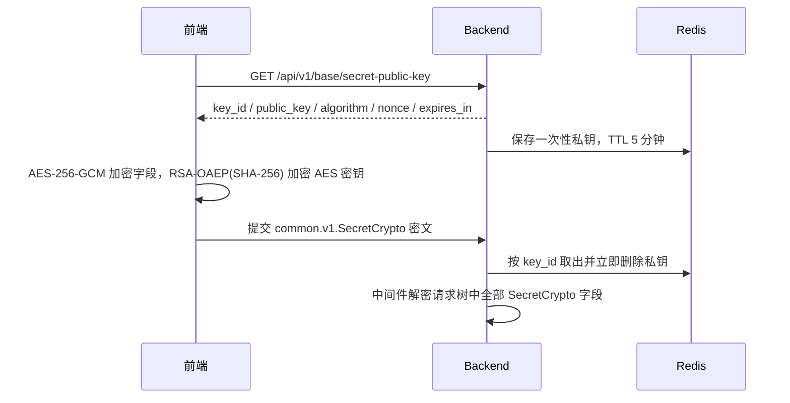

# 敏感字段加密设计

> 更新：2026-11-06。本文描述当前代码机制；生产环境的密钥、存量数据和 HTTPS 仍需单独验证。

本文记录敏感数据在提交、存储、查看三个环节的加密机制。三者相互独立、按需组合：传输层保护请求在网络中的密文，落库层保护数据库列的静态存储，配置加密保护 YAML 文件中的敏感值。

| 层次 | 机制 | 保护对象 | 关键实现 |
| --- | --- | --- | --- |
| 传输 | `common.v1.SecretCrypto` 临时公钥加密 | 登录密码、修改密码、OAuth/消息 Provider 凭据、AI API Key、表单配置值等请求字段 | `backend/internal` 的 HTTP/gRPC 解密中间件 |
| 落库 | redact 入库策略及配置值信封加密 | 用户敏感字段、供应商/客户端密钥、TOTP 密钥、`base_config` 敏感值 | `backend/adapter/kit/redact_storage_*`、`secretfield_storage.go` |
| 配置 | `ENC[...]` 密文前缀 | YAML 配置文件中的敏感值 | 后端配置加载器 |

## 传输层：SecretCrypto 临时公钥加密

需要保密的请求字段在 Proto 中声明为 `common.v1.SecretCrypto` 类型，包含 `key_id`、`nonce`、`algorithm`、`encrypted_key`、`iv`、`text` 六个字段。`text` 传输时为密文，服务端解密后回填明文。

- 公钥由 `base.v1.SecretCryptoService/GetSecretPublicKey`（`GET /api/v1/base/secret-public-key`）发放，位于 authn 白名单，无需登录。同一次提交的多个密文字段共用该公钥。
- 算法标识 `RSA-OAEP-256+A256GCM`；私钥写入缓存，TTL 5 分钟，取出即删，同一密文不能重放。
- 解密由后端统一中间件完成，挂载于 gRPC 与 HTTP（`backend/internal/module/module.go`），递归处理请求消息树中全部 `common.v1.SecretCrypto` 字段，业务代码拿到的已是明文。
- 前端封装在三端 core 的 `src/utils/secretCrypto.ts`，优先 Web Crypto，缺少时回退 `asmcrypto.js`；协议细节与 HTTPS 边界见 [登录与密码加密流程](登录与密码加密流程.md)。

当前声明为 `common.v1.SecretCrypto` 的字段：

| Proto | 字段 |
| --- | --- |
| `base/v1/login.proto`、`mfa.proto`、`oauth.proto` | `password` |
| `system/admin/v1/auth.proto` | `old_pwd`、`new_pwd` |
| `system/admin/v1/base_user.proto` | `pwd` |
| `system/admin/v1/base_login_policy.proto` | `initial_password` |
| `system/admin/v1/base_config.proto` | `value`（表单配置整值） |
| `system/admin/v1/base_oauth_provider.proto` | `client_secret` |
| `system/admin/v1/base_message_provider.proto` | `client_secret` |
| `system/admin/v1/ai_provider.proto` | `api_key` |

## 落库层：策略加密与配置值信封

业务字段由 `RedactPolicyResolver` 加载 `base_redact_storage_policy` 和 `base_redact_rule`：

- `ENCRYPT` 策略使用 AES-GCM 或 SM4-GCM，随机 12 字节 nonce，密钥由运行时主密钥按 `kratos-admin:redact/field` 独立派生。凭据列加密后保存，服务端查询回调解密供业务使用。
- 手机、邮箱、证件号等可使用主表脱敏、旁表加密原文及摘要查询。旁表保护器使用独立派生名 `kratos-admin:redact/storage`；摘要用于等值检索，不替代原文加密。
- 默认租户策略作为全局策略，其他租户按字段覆盖；出库策略按 operation、Proto message 和 field 精确匹配，由服务端生成的 redactor 执行。前端隐藏不能替代出库脱敏。
- 种子覆盖用户敏感字段、供应商/开放客户端密钥和 TOTP secret。宿主新增个人信息、业务凭据、导出或 SSE 字段时必须补对应存储/出库策略和权限，基础种子不能保护未知业务表。

`base_config` 由 `SecretFieldRuntime` 保护：敏感整值和表单 JSON 中登记的敏感路径使用 `sbox:v1:` 信封，AES-256-GCM、随机 nonce，独立派生密钥，AAD 绑定表列。查询不自动解密，只有 `GetConfigValue`、`DecryptConfigSensitiveFields` 等服务端出口可以解密。

启动时先加载 redact 策略，配置回调跳过已由策略保护的业务表，随后调用 `BackfillConfig` 回填配置敏感值，再迁移旧格式 TOTP。**没有全业务表自动回填**；修改 `v0.0.1` 种子不会自动更新存量数据库，也不会自动加密历史业务行。历史直接加密字段仍兼容明文读取，必须备份后按实际表结构分批重存并核对解密、掩码和摘要查询结果，不能把兼容读取当成已完成加密的证据。

## 查看层：RevealSecretField

- 接口为 `base.v1.SecretCryptoService/RevealSecretField`（`POST /api/v1/base/secret-field/reveal`）。认证身份必须为默认租户的平台 `super/admin`，同时仍受现有接口授权控制。
- 只允许 `ai_provider.api_key`、`base_oauth_provider.client_secret`、`base_message_provider.client_secret`，并要求默认租户配置了对应直接加密策略。使用生成的类型化查询，不接受动态表列查询。其他租户的客户端密钥、用户认证器和任意新加密表均不能通过此接口读取。
- 管理端 System 的 `registerSecretRevealHandler` 为已配置密钥提供按需查看。列表只返回配置状态，不返回密钥；普通前端遮挡不是安全边界。
- 明文查看写入数据访问审计，记录操作者、资源、记录 ID、字段及结果；不记录响应 `text` 或实际密钥。日志快照也统一过滤 token、secret、cookie 等敏感键。

## 配置文件加密：ENC[...]

YAML 配置中的敏感值使用 `ENC[...]` 前缀密文，由后端配置加载器在启动时通过运行时密钥提供器解密。它只作用于配置文件内容，与请求传输和落库加密无共享密钥。

## 关键入口

| 领域 | 路径 |
| --- | --- |
| 传输加密 Proto | `backend/api/proto/base/v1/secret_crypto.proto` |
| 密钥查看 Proto | `backend/api/proto/base/v1/secret_crypto.proto` |
| 请求解密与中间件 | `backend/internal/module/module.go` |
| 落库信封运行时 | `backend/adapter/kit/secretfield_storage.go` |
| 后端公钥与查看实现 | `backend/internal/biz/base/secret_crypto.go` |
| 前端加密封装 | 三端 `packages/core/src/utils/secretCrypto.ts` |
| 眼睛组件与回调 | `frontend/admin/packages/core/src/components/ProForm/components/SecretInput.vue`、`frontend/admin/packages/core/src/utils/secretCrypto.ts` |

## 新增敏感字段

1. 请求凭据在 Proto 中使用 `common.v1.SecretCrypto`，执行项目生成命令。
2. 按数据归属配置入库策略、出库策略及受控明文例外；配置 JSON 路径登记到 `runtimeconfig.SensitiveFields`。
3. 同步页面、权限、初始化数据、存量迁移方案和安全回归，检查列表、详情、导出、SSE 与日志均不会泄漏。
4. 运行后端测试、受影响前端检查和 `make i18n`。新增字段不会自动获得明文查看权限。

密钥轮换须保留旧密钥到历史密文完成重加密和恢复验证后；直接替换主密钥会使现有配置、凭据及旁表原文无法解密。部署与复测清单见 [漏洞整改记录](漏洞整改记录.md)。
