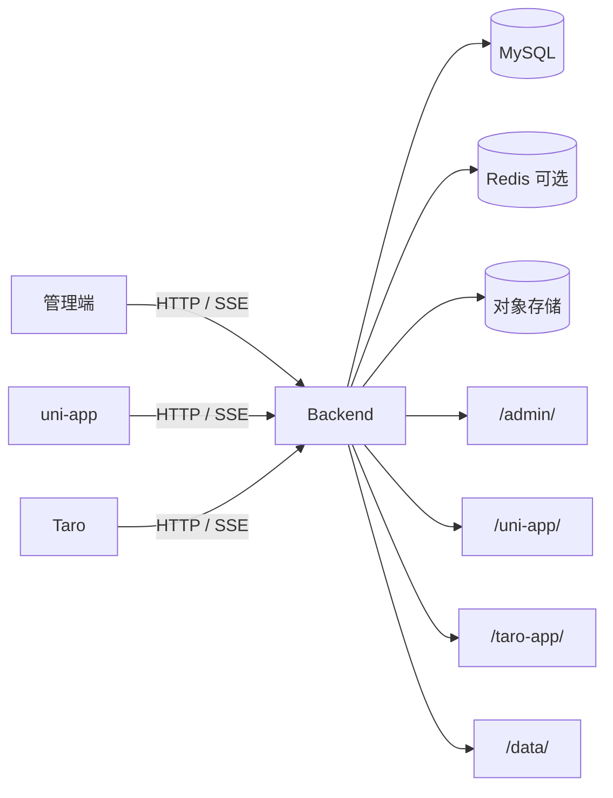

# 系统总体设计

本文只描述 `kratos-admin` 当前仓库的目录职责、运行关系和生成链路。其他项目的实现、接入和发布方式不属于本文范围。

## 模块职责

| 模块 | 当前职责 | 主要产物 |
| --- | --- | --- |
| `backend` | HTTP/gRPC 服务、认证授权、MFA、开放授权、系统业务、AI、任务、迁移和静态资源托管。 | Go 服务、OpenAPI |
| `frontend/admin/packages/core` | 管理端启动、认证、MFA、动态路由、布局、主题和公共组件。 | `@liujitcn/kratos-admin-core` |
| `frontend/admin/packages/modules/system` | 用户与组织、系统配置、日志、任务、个人中心、安全、AI 和开发工具页面。 | `@liujitcn/kratos-admin-system` |
| `frontend/admin/packages/modules/rag` | AI 知识库管理页面。 | `@liujitcn/kratos-admin-rag` |
| `frontend/admin/packages/cli` | 创建管理端业务 workspace 的脚手架。 | `@liujitcn/kratos-admin-cli` |
| `frontend/admin/apps/admin` | 组合 core、System 和 RAG 的默认管理端宿主。 | `backend/web/admin` |
| `frontend/uni-app` | H5 和微信小程序应用端，提供登录、首页、个人中心、消息和 AI。 | `backend/web/uni-app` |
| `frontend/taro-app` | React/Taro 应用端，提供与 uni-app 对齐的 H5 和微信小程序能力。 | `backend/web/taro-app` |
| `backend/migration` | 唯一初始化版本的数据库脚本、默认数据、菜单、权限和多语言资源。 | 内嵌 SQL |

仓库当前没有商城、订单、支付或推荐业务模块。

## 运行关系



后端可以作为独立进程启动，也可以在本仓库的启动装配中复用同一套 Service、Biz、Data 和任务实现。所有入口共享同一份 Proto 契约和配置目录。

## 后端分层

```text
backend/api/proto
  -> backend/api/gen
  -> backend/internal/service
  -> backend/internal/biz
  -> backend/internal/data
```

- Proto 是 HTTP、gRPC、校验、OpenAPI 和前端 RPC 的唯一契约源。
- Service 负责请求/响应适配、日志和错误兜底；业务规则放在 Biz；数据库访问限制在 Data。
- `backend/internal/module` 负责模块注册、任务、SSE、队列消费者和静态资源装配。
- `backend/internal/cmd/server` 是独立进程入口；`backend/internal/openapi` 保存生成的 OpenAPI 资源。
- 生成的 Go、TypeScript、GORM 和 Wire 文件只能通过项目命令更新。

## 前端依赖方向

管理端：

```text
apps/admin -> packages/modules/system / packages/modules/rag -> packages/core
```

uni-app：

```text
apps/uni-app -> packages/modules/system -> packages/core
```

Taro：

```text
apps/taro-app -> packages/modules/* -> packages/ui -> packages/core
```

宿主只负责组合和平台配置；业务模块通过公开 exports 使用底座能力。动态菜单只下发稳定 `viewKey`，不能下发任意组件路径。页面 wrapper、分包配置和临时静态资源由构建插件生成，源代码中不提交这些临时文件。

## 数据与安全边界

- MySQL 保存业务、权限、日志、任务、迁移和站内信事实数据。
- AI 知识库按 `data.databases.rag` 配置使用独立数据源；未配置时回落默认数据源。
- Redis 用于缓存、分布式锁、队列和消息恢复；未配置时单实例使用进程内实现。
- 文件服务统一通过对象存储配置提供本地或 S3 兼容存储，公开文件与登录文件使用不同访问策略。
- 密码、API Key、OAuth/消息 Provider 凭据和配置敏感字段分别经过传输加密、落库信封加密和按权限查看，详见[敏感字段加密设计](敏感字段加密设计.md)。
- 租户、项目、角色、部门、岗位和用户授权全部由服务端重新计算，客户端只保存展示所需状态。

## 生成与检查链路

| 命令 | 输出或作用 |
| --- | --- |
| `make -C backend api` | 生成 Go 协议代码和 OpenAPI 源文档 |
| `make -C backend gorm-gen` | 生成 GORM Model、Query 和 Data 装配 |
| `make -C backend public-wire` | 生成后端公共模块装配 |
| `make -C backend wire` | 生成独立服务入口装配 |
| `make -C frontend ts-admin` | 生成管理端 core、System 和 RAG RPC |
| `make -C frontend ts-uni-app` | 生成 uni-app RPC |
| `make -C frontend ts-taro-app` | 生成 Taro RPC |
| `make gen` | 按依赖顺序生成全仓产物 |
| `make check` | 执行后端、三个前端和国际化检查 |

接口改动按“Proto → 生成 → Service/Biz → 前端请求与页面 → 初始化数据和权限”完成。初始化资源统一维护在 `backend/migration/assets/v0.0.1/mysql`，不新增其他版本目录。

## 文档入口

| 主题 | 文档 |
| --- | --- |
| 功能总览 | [功能总览](功能总览.md) |
| 后端 | [backend README](../backend/README.md) |
| 管理端 | [frontend/admin README](../frontend/admin/README.md) |
| uni-app | [frontend/uni-app README](../frontend/uni-app/README.md) |
| Taro | [frontend/taro-app README](../frontend/taro-app/README.md) |
| 服务接入 | [服务接入指南](服务接入指南.md) |
| 数据库 | [数据库与初始化数据设计](数据库与初始化数据设计.md) |
| 认证安全 | [登录与密码加密流程](登录与密码加密流程.md)、[敏感字段加密设计](敏感字段加密设计.md) |
| AI | [AI助手设计](AI助手设计.md) |
| 消息 | [站内信设计](站内信设计.md) |
| 日志与运维 | [日志与审计设计](日志与审计设计.md)、[安全策略与运维任务](安全策略与运维任务.md) |
